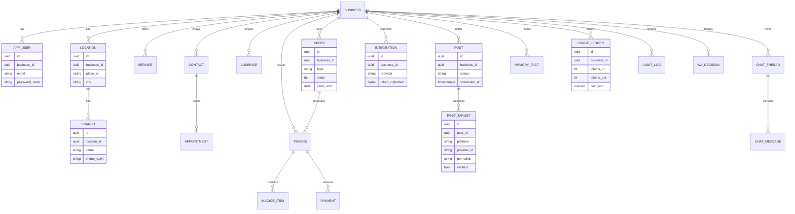
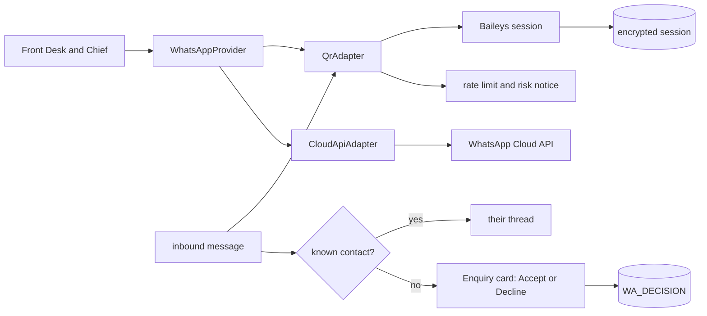
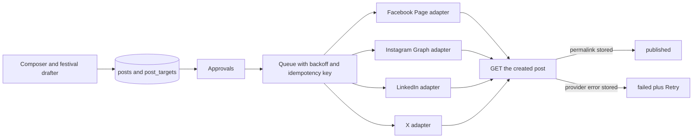

# Phase 0 — Recon

Inspected **10 Nov 2026** against `origin/main` at `ec1750e` (“Changes landing page”). No application code was changed. The live sites (`http://54.81.208.96:3000/` and `https://aaa-s-e75e.vercel.app/`) were not clicked through in this pass; every status below is from the source on that commit.

QA source: findings doc written by Syed Saadh (Intelligenz IT), 10 Nov 2026, 19 screenshots. Issue IDs are the ones in the master prompt. The findings doc itself does not use those IDs.

**Settled for later phases (owner):** commit on `main`. One commit per issue ID. Push only when build and tests are green. Never commit secrets. Never force-push or rewrite history. Tag `pre-phase-N` on `main` before that phase’s code. `pre-phase-1` points at the commit that adds this file. Do not deploy to production from this program. After this recon, phases run in order without waiting for a continue.

**Settled product choices (owner, later the same day):**

- **Payments.** Razorpay is the payment gateway: Orders, Checkout, webhook signature checks, and payment status on Billing. UPI stays as a method inside Razorpay, not a side path. Keys are only `RAZORPAY_KEY_ID`, `RAZORPAY_KEY_SECRET`, `RAZORPAY_WEBHOOK_SECRET`. Default is test mode. Never commit keys.
- **Landing prices.** LND-1 stands: the marketing page includes ₹ plans and the free starter credit.
- **Skip the API key.** ONB-6.3 stands: skip uses the platform key with a hard $1.00 lifetime cap per account.
- **Scope.** Every issue in the master prompt and the QA doc. Anything that needs a human key, domain, Meta review, or AWS account is built behind env and listed under Needs from owner. It does not stop the next phase.

## 1. Repo map

Node 20 app. There is no React, Next, or Express app. `package.json` version on this commit is **2.7.0**.

1. **Framework.** Plain Node ESM. `server.js` is an `http` server that serves HTML files and `/api/*`. The clinic UI is one file, `clinic.html`. The workplace (Chief, Bot Mode, connectors) is `index.html`. The public home is `home.html`.
2. **Router.** Path checks in `server.js` `serve()`, plus `handle()` in `lib/backend.js`. Vercel uses `vercel.json` rewrites into `api/index.js` (same handler, region `sin1`, one cron). Industry URLs (`/clinic`, `/Realestate`, `/Aesthetic`, …) all return `clinic.html`; `lib/clinic-packs.js` maps the path to a pack.
3. **Auth.** Email and password in `lib/backend.js` (scrypt hashes, session token includes a version `sv`). Google and email-code in `lib/authx.js`. Reset in `lib/pwreset.js`. Clinic sign-in is the screen at `/Aesthetic` inside `clinic.html`. Workplace sign-in lives in `index.html` and is reached at `/app`.
4. **DB.** No ORM and no row-level tables for the product. `lib/db.js` stores one JSON document per key in Postgres table `agentsphere_kv` (Neon serverless driver for `*.neon.tech`, otherwise `pg`). No `DATABASE_URL` falls back to `data/kv.json`. Tenancy is the key prefix plus the account email (`as_clinic:<email>`, `as_data:<email>`, …). There is no `business_id` column and no Postgres RLS.
5. **Env names that matter.** `SESSION_SECRET`, `DATABASE_URL`, `APP_URL`, `HOSTED`, `GOOGLE_CLIENT_ID`, `GOOGLE_CLIENT_SECRET`, `OPENROUTER_API_KEY`, `OPENROUTER_MODEL`, `AI_PROVIDER`, `PLATFORM_AI_BUDGET_USD`, `AWS_BEARER_TOKEN_BEDROCK`, `BEDROCK_REGION`, `COMPOSIO_API_KEY`, `RAZORPAY_KEY_ID`, `RAZORPAY_KEY_SECRET`, `RAZORPAY_WEBHOOK_SECRET`, `CLINIC_WA_PROVIDER`, `CLINIC_WA_META_TOKEN`, `CLINIC_WA_META_PHONE_ID`, `WHATSAPP_QR`, `GMAIL_USER`, `GMAIL_APP_PASSWORD`, `SMTP_HOST`. Full name list is in section 7. `.env` is gitignored. **`.env.example` is not on this branch.**
6. **Integrations present in this tree.** Composio (`lib/composio.js`, `lib/composio-account.js`, `lib/connectors.js`). OpenRouter, OpenAI, xAI, Gemini, Anthropic, Bedrock (`lib/aikeys.js`, `lib/llm.js`). Meta WhatsApp Cloud and Gupshup (`lib/clinic-whatsapp.js`, `lib/channels.js`). Baileys QR, owner-chat only (`lib/waqr.js`). LinkedIn, X, Facebook, and Instagram are Composio tool slugs plus Playwright browser actions (`lib/orchestrator.js`, `lib/browser.js`). **No Buffer client on this branch.**
7. **Deploy.** Two targets are both described. Vercel: `vercel.json`, `scripts/vercel-build.mjs`, staging notes in `README.md`. EC2: `deploy/aws/` (nginx, Docker, Postgres) and `deploy/https/` (Caddy). The HTTPS guide names the box `54.81.208.96` and the stand-in host `54-81-208-96.sslip.io`. `/` serves `home.html` unless `AIDENTIFY_SITE=landing`, which serves `landing-v2.html`.

### How `main` relates to `v2.8`

`origin/main` and `origin/v2.8` have **no merge base**. They are two imported histories.

| | `main` | `v2.8` |
|---|---|---|
| Tip | `ec1750e` (10 Nov 2026) | `1eedeed` (4 Nov 2026) |
| Tag | none on this tip | `v2.8.0-beta.5` → `1eedeed` |
| Commits | 4, first is a full-tree import `dcf99f1` (5 Nov) | 6, ending at the landing-without-prices commit |
| Version | 2.7.0 | 2.8.0 |
| PR | — | PR #1 closed, not merged |

The three commits after the import only touch the landing and Google sign-in (`a22930a`, `b180621`, `ec1750e`). They do not bring `v2.8` across.

**Already on `main` (same product family as the import):** eight industry packs, BYOK keys, forgot-password, Google OAuth code, Composio, clinic invoices with UPI and Razorpay test links, festival list plus an on-demand festival draft, approvals, export / delete-data / delete-account, Meta/Gupshup templates, owner-only Baileys QR, agency white-label (`lib/agency.js`).

**On `v2.8` and absent from `main`:** `lib/buffer.js` (Buffer GraphQL), `lib/crm.js` (native CRM), `lib/upi.js` plus `assets/upi-qr.png` (plan checkout by UPI), `lib/clinic-waqr.js` plus `worker.js` (customer WhatsApp QR into the CRM), `lib/cost.js`, `lib/itemstore.js`, `lib/legal.js`, `lib/computer-guard.js`, `deletion.html`, `privacy.html`, `terms.html`, `.env.example`, the Playwright onboard spec, k6 and eval scripts. Package version 2.8.0.

The public landing on `main` (`home.html`) also has no prices. That is a separate rewrite in the November landing commits, not the `v2.8` landing commit.

## 2. Issue tracker

Status means the **current `main` source**, not a live click.

| ID | Status | Where | What the code does |
|---|---|---|---|
| AUTH-1 | Partial | `clinic.html` 540–558, 1270, 1766; `index.html` 1499–1518 | Clinic sign-in and create-account have an eye toggle. Clinic reset and delete-account password fields do not. Workplace `index.html` adds an eye to password fields it renders. |
| AUTH-2 | Partial | `lib/pwreset.js`; `clinic.html` 529–545; `index.html` 1508–1531 | Request, SHA-256 of a single-use token, 30 min expiry, `sv` bump on success. Generic copy when mail is on. When `GMAIL_USER` / SMTP is unset, the API says mail is off instead of sending. Live success depends on mail env. |
| AUTH-3 | Confirmed | `clinic.html` 558; `lib/authx.js` 42–48; `index.html` 1452–1457 | Clinic always shows “Continue with Google”. If the env pair is missing, the server redirects to `#as_autherr=` with the raw “isn’t set up on this server” text. Workplace hides its button when `/api/auth/providers` says google is false. Redirect URI in code is `{APP_URL}/api/auth/google/callback`. |
| AUTH-4 | Unclear | `lib/backend.js` 478; `clinic.html` 748, 1702, 1831 | The sentence “Your email or password is incorrect.” is only thrown by `POST /api/auth/login`. The brief prints the shared `err`, and any failed `api()` becomes a toast. No onboarding handler calls login. Needs a live network trace. |
| AUTH-5 | Confirmed path | `clinic.html` 1359–1362, 1444; `index.html` 1573–1588 | Bot Mode iframes `/app?bot=1#as_auth=<token>`. If that token fails `/api/auth/me`, or the hash is missing, `index.html` calls `showAuth()` inside the frame. |
| AUTH-6 | Confirmed path | `home.html` 14–18; `server.js` 50–59; `clinic.html` 434, 1444; `index.html` 1574 | Several full-document redirects (`/` → `/app`, clinic `?bot=1` → `/app`, unsigned `/app` → `/Aesthetic`) plus an iframe of the whole workplace. That is enough to flash Admin → page → chat. No single server-resolved session. |
| AUTH-7 | Confirmed | same as NAV-1 | |
| AUTH-8 | Partial | same as DATA-2 | A delete-account form exists. It is not the DATA-2 job. |
| ONB-1.1 | Confirmed | `clinic.html` 1732–1739 | A category tile sets the radio and, after 320 ms, calls `obShow(step+1)`. OK is not required. Empty OK says “Pick the kind of business you run.”, not “Please select a business category to continue.” |
| ONB-1.2 | Confirmed | `lib/clinic-packs.js` `PACKS` | Tiles are dental, aesthetic, coach, realestate, studio, home, institute, other. No Digital Marketing Agency pack. `landing-v2.js` lists that label for the marketing page only. |
| ONB-2.1 | Confirmed | `clinic.html` 698, 736, 798–853 | Green check is “non-empty trim”. `maxlength="80"`. No letter rule, no email reject, no `n/60` counter. Header uses `ob.biz` as typed (`obPaintTrack`). |
| ONB-2.2 | Confirmed | no Places client | No Google Places call, no dropdown, no place details. |
| ONB-3.1 | Confirmed | `clinic.html` 718, 738, 853 | City is a free-text input plus a datalist. Any non-empty string, including an email, is valid. |
| ONB-3.2 | Confirmed | `lib/clinic.js` clinic record; `clinic.html` city step | One `city` string. No `locations[]` / `branches[]`, no CSV of branches. Suggestion chips exist for eight cities. |
| ONB-4.1 | Confirmed | `clinic.html` 701–707, 853 | A service chip is any non-empty string up to 80 chars. Digits pass. Dedupe is case-insensitive. No “must contain a letter”. |
| ONB-4.2 | Partial | `lib/clinic-packs.js` `publicPacks().suggest`; `clinic.html` 741 | Industry suggestion chips exist. They are split from the pack’s sample sentence, not a curated service list, and custom entry is still unvalidated. |
| ONB-4.3 | Confirmed | `lib/clinic.js` `profile.offer` string | One free-text offer on the older 15-minute wizard (`clinic.html` 877). No percent/flat offer records, no coupon schema. |
| ONB-5.1 | Confirmed | `clinic.html` 742, 853 | Same chip rule as services. A numeric audience is accepted. |
| ONB-5.2 | Confirmed | no LLM call on this step | Audiences are four hardcoded chips plus the pack’s one sample line. No prediction call, no pre-select of three. |
| ONB-6.1 | Confirmed | `clinic.html` 744–745, 1723 | On the 7-step flow, OK on “Connect your AI” only advances. It does not call `/api/ai/key`. The separate 15-minute wizard (`setupView`, step 6) does have “Test & save”. QA’s step 6 of 7 is the first flow. Server `checkKey` exists for when a key is actually posted. |
| ONB-6.2 | Partial | `clinic.html` 562–605, 1780–1816; `lib/aikeys.js` | Region block is `hidden` unless the provider has `regions` (Bedrock only). Models reload on provider change. Save does not prove the chosen model id is enabled on that key. |
| ONB-6.3 | Confirmed | `clinic.html` 1725; `lib/aikeys.js` 1–11, 144–152; `lib/clinic.js` BYOK gate | Skip clears the key field and moves on. It is not labeled “validated”, and it does not attach a platform key. Clinic copy says agent calls stay off until a key is saved. `PLATFORM_AI_BUDGET_USD` is a shared pool for the workplace (default daily user allowance $0.50), not a $1 lifetime cap and not an upgrade modal. |
| ONB-6.4 | Partial | `lib/aikeys.js` 37–48, 100–118 | AES-256-GCM with a key derived from `SESSION_SECRET` (not KMS). Stored under `as_aikey:<email>`. Summary returns last-4 only. Decrypt failure is logged without the key. Not envelope/KMS, and the cipher is only as secret as `SESSION_SECRET`. |
| ONB-7 | Unclear | `clinic.html` 730–748, 657–664 | The brief rows are Business, Name, City, Services, Customers. Email is not one of those fields. A bad city or a numeric name is shown as-is, which matches “brief shows unvalidated data”. The “email in the City slot” report matches ONB-3.1 (an email accepted as city), not a field mix-up in the template. |
| NAV-1 | Confirmed | `clinic.html` 616–633, 770–784, 1724 | Steps are an in-memory index `ob.step`. The in-app Back button moves that index. The URL does not change, so the browser Back button leaves the page. Draft is not written to the DB per step. A failed `reload()` clears the token and sends the user to sign-in (`clinic.html` 1845). |
| NAV-2 | Partial | `clinic.html` 1845; `index.html` 1574–1588 | Signed-out `/app` goes to `/Aesthetic`. There is no `/onboarding/step/3`, no `returnTo`, and no server rule that an unfinished clinic profile resumes its step. Refresh keeps data only if `reload()` succeeds and the client still holds `ob`. |
| NAV-3 | Confirmed absent on the clinic dashboard | `index.html` 3042 | Workplace has a “Take the product tour” menu item. The clinic dashboard has a “Meet Chief” callout (`clinic.html` ~1405), not a Next/Back/Skip tour with `tour_completed`. |
| DSH-1 | Partial | `clinic.html` `dash()` 976–999, `kpis()` 930–944 | Home already has recovered, payments due, today’s bookings, open enquiries, needs-approval, and a bar split of recovered revenue. Sample rows are seeded and some pills say DEMO; the sample banner was removed (`banner()` returns ''). Owner Insights is still its own sidebar item. Setup checklist is import / form / approve, not integrations. |
| DSH-2 | Confirmed | `clinic.html` `front()` 1084–1120, `side()` 905–928 | Front Desk is inline forms (“Add enquiry”, “Add appointment”) plus per-agent sidebar buttons for recall and reviews. Not two primary buttons opening modals. |
| DSH-3 | Confirmed | `lib/clinic.js` draft routes ~1355–1382 | Separate draft actions (reminder, recall, review, referral, invoice). No one state machine from enquiry to paid to referral, and no event row per transition. |
| DSH-4 | Partial | `lib/clinic.js` 1600–1694; `lib/clinic-payments.js`; `clinic.html` 1219–1238 | Invoice numbers look like `INV-1003` on the sample, not `INV-2026-0001` per business. GST is one optional percent. Copy says there is no GSTIN. Line items exist. Offer is not applied as a coupon. Statuses are paid/unpaid plus a derived overdue. Mark paid exists. Payment link is a UPI deep link, or a Razorpay **test** Payment Link when `RAZORPAY_KEY_ID` starts with `rzp_test_` (a live key is ignored). PDF is a plain text dump (`invoicePdf`), HTML print is a list of `
` lines. Reminder is an approval draft with a `wa.me` link; quiet hours are stored and consulted by `reminderGate`. |
| DSH-5 | Partial | `lib/clinic-packs.js` | One pack object per industry drives labels, sample rows, and prompts, and the same `clinic.html` renders all of them. Layout still branches (`visitKit` for dental/aesthetic, per-agent sidebar). Packs are not `config/industries/*.ts`. No digital-marketing pack. Offers are one string. |
| DSH-6 | Partial | `clinic.html` `connections()` ~1332; `lib/connectors.js` 458; `lib/channels.js` 669 | Workplace connectors have disconnect (`/api/connectors/disconnect`, `/api/channels/disconnect`). The clinic Connections screen is CSV, the booking form, and Eka.care. It does not list Gmail, Calendar, WhatsApp, Facebook Page, Instagram, LinkedIn, and X with Connect / Reconnect / Disconnect. |
| CHF-1 | Partial | `lib/orchestrator.js` system prompt; `lib/clinic.js` `/api/clinic/chat` | Workplace Chief is a tool-using operator, not a short Indian-English business assistant loaded from versioned config. Clinic chat is a separate, smaller prompt over clinic records. |
| CHF-2 | Partial | `lib/orchestrator.js` 12, 138 (`as_mem:<email>`); `lib/clinic.js` chat history slice | Workplace stores a flat fact list per agent and sends the last 10 turns. No thread sidebar, no rolling summary, no pgvector. Clinic chat keeps the last 6 turns in the browser (`clinic.html` 1697). |
| CHF-3 | Partial | `lib/orchestrator.js` 542–549, `decideApproval` | The prompt says to quote tool errors and not claim a comment before approval. There is no `{status, provider_id, verified}` contract, and no test that a failed Instagram publish must surface as failure. Browser posting is still an allowed fallback. |
| CHF-4 | Confirmed | no edit-last-message path in `index.html` or `clinic.html` | “regenerate” in `index.html` is a lead-status word, not chat edit. |
| CHF-5 | Confirmed path | same as AUTH-6 | |
| INT-1 | See section 4 | `test/flows.test.mjs` 53–59 | This branch rejects Buffer as a connector and does not list it. The personal account is not in this tree. `v2.8` still has the client. |
| INT-2 | Confirmed | `lib/orchestrator.js` `NET`, `socialPlaybook` | No `posts` / `post_targets` tables, no status machine, no BullMQ/SQS. Publishing is Composio tool calls plus Playwright. Instagram instructions in the prompt do describe container → poll `FINISHED` → publish, but nothing in our code performs or verifies that sequence. |
| INT-3 | Unclear | `lib/orchestrator.js` LinkedIn bullet | No first-party LinkedIn client, no request log, no refresh, no 429 backoff. Intermittent failures cannot be rooted in this tree. They would be Composio or the browser session. |
| INT-4 | Confirmed | `lib/orchestrator.js` 529, 546 | Prompt text says Facebook Page, and also tells the model to use the browser for groups and other pages. There is no Page picker and no `pages_manage_posts` token stored by us. |
| INT-5 | Confirmed | `lib/composio.js`, `lib/orchestrator.js` 542 | X is a Composio toolkit (`twitter` slug), same path as the other networks. No PKCE client of our own. |
| INT-6 | Partial | `lib/festivals.js`; `lib/clinic.js` 1384–1414; `clinic.html` ~1200 | Built-in India list for 2026–2027, plus optional Google Calendar. The Social screen can draft a festival post into Approvals when the user asks. Nothing schedules that draft 7 days ahead, and nothing publishes on approve. |
| INT-7 | Partial | `lib/waqr.js`; `lib/clinic-whatsapp.js` | Baileys exists, gated by `WHATSAPP_QR`, encrypted session, off on Vercel. It only talks to the owner’s own number (`waqrMaySend`). Cloud API is a separate Meta/Gupshup template sender, not a `WhatsAppProvider` beside a QR adapter. `v2.8`’s `lib/clinic-waqr.js` (customer messages → CRM) is not on `main`. |
| INT-8 | Confirmed | `lib/waqr.js` 30–39 | Unknown numbers are dropped. No Accept/Decline card, no “never ask again” record, no auto-reply rules. |
| INT-9 | Partial | same as DSH-6 | Disconnect exists on the workplace connector API. The clinic Connections screen does not offer it for Gmail. |
| DATA-1 | Confirmed | `lib/db.js` 1–60; `lib/backend.js` `SERVER_ONLY` / `PER_USER` | One KV table. Passwords are scrypt (not argon2id). Tokens are AES-GCM from `SESSION_SECRET`, not KMS. Migrations are four `CREATE TABLE` statements in `lib/db.js`, not product tables. |
| DATA-2 | Partial | `clinic.html` 1265–1270; `lib/clinic.js` 1704–1712; `lib/backend.js` `removeAccountData` | Export is one JSON file. “Delete my data” requires the phrase `delete my data` and wipes the clinic blob, not the login. “Delete this account” asks for the password. No business-name confirm, no provider revoke sweep, no vector purge, no background job, no completion email. |
| DATA-3 | Partial | `lib/obs.js`; approval rows in `lib/orchestrator.js` | Request logs and approval decisions exist. There is no audit row with approver, payload hash, and provider response for every external send. |
| PERF-1 | Confirmed risk, numbers not measured | `index.html` polls at 5s, 15s, 20s, 60s (`setInterval` near 1254, 1369, 4283, 4381, 4716); `board.html` 160; `clinic.html` is one large document | No Lighthouse run in this phase. The workplace keeps several timers. Lists are not paginated at 25. Clinic and workplace are multi-hundred-KB HTML documents with no route split. |
| LND-1 | Confirmed | `home.html`; `server.js` 50–56; `landing-v2.html`; `lib/pricing.js` | `/` is `home.html`: hero, problem, benefits, how-it-works, who, features, FAQ. CTA is “Get Started Free”, not “Build my AI team — free”. No industry tiles with Digital Marketing first, no agent-outcome cards in the LND-1 order, no pricing block. `landing-v2.html` still has `{{SELF_INR}}` / `{{HOSTED_INR}}` tokens and is what `/v2` and `AIDENTIFY_SITE=landing` serve. |

### Findings in the QA doc that the master prompt does not carry as written

The master prompt covers the same bugs and assigns IDs. These details in the doc disagree with it or are easy to lose:

- **Character limits disagree.** The doc’s business-name example is 2–100 with a `25/100` counter, and Module 7 later says 0–30 on “relevant” fields. The master prompt says name 2–60, service 2–40, audience 2–60. Current inputs use `maxlength="80"`.
- **Skip-for-now in the doc is the softer version.** The doc says skipping must not look like a validated key, and that Settings can hold the key later. It does not ask for a platform default key. The master prompt’s ONB-6.3 adds the $1 cap. See decision (b).
- **City, doc vs prompt.** The doc’s issue 3.2 asks to make the eight city chips and free text behave consistently. The master prompt replaces City with locations, branches, and a CSV for 100+ branches.
- **Numbering in the doc does not match the IDs.** Doc “issue 5.2” is duplicate audiences. Master ONB-5.2 is AI prediction. Doc “issue 6.4” is skip behaviour. Master ONB-6.4 is encryption. Doc “issue 8.1” is the Back button (master NAV-1).
- **Instagram sentence.** The doc quotes “Instagram's Create button in the browser is not accessible to automation…”. That sentence is not in `main` or `v2.8` source. The mechanism is: `lib/orchestrator.js` tells the model to post with the browser when Composio fails, and to explain the failure. Treat the sentence as model copy from that path until a live log says otherwise.
- **“Shreyas” Buffer account.** The name is in the doc and in no file on `main` or `v2.8`. See section 4.
- **Doc execution line.** The doc tells the agent to push straight to `main`. That is the rule for the phases after this one. This file is the Phase 0 commit.

## 3. Proposed architecture

Today’s database is the KV table in `lib/db.js`. The diagram below is the Phase 3 shape from DATA-1. Every row carries `business_id`. The repository (or RLS) refuses a query without it. Existing `as_*` keys get a one-way migration; the KV table stays until that migration has been checked.

`OFFER.type` is `percent` or `flat`. `POST.status` is `draft → approved → scheduled → publishing → published | failed`. `WA_DECISION` stores unknown-number Accept/Decline only. Declined message bodies are not stored.

WhatsApp stays behind one interface. QR is the default. Cloud API is a stub until a Meta app exists. The connect screen shows the one-line ban warning that `lib/waqr.js` already words, and outbound sends are rate-limited.

`QrAdapter` is the current Baileys socket, extended so customer chats are not dropped. `CloudApiAdapter` wraps the Meta path in `lib/clinic-whatsapp.js` and returns the same `{status, provider_id, verified, error}` shape. Vercel cannot hold the socket; the QR process stays on the EC2 box (`v2.8`’s `worker.js` is the pattern, and it is not on `main`).

Social posting leaves Buffer and leaves the browser. Composio may remain only as the OAuth handshake for a network that has no app of our own, and that choice gets written down in Phase 5. The browser “Create / Share / Post” path in `lib/orchestrator.js` comes out.

Instagram adapter, in order: `POST /{ig-user-id}/media`, poll `status_code` until `FINISHED`, `POST /{ig-user-id}/media_publish`, then `GET /{media-id}?fields=permalink`. The image is a public JPEG URL. Facebook adapter uses a Page token and a Page picker. The UI says personal profiles cannot be posted to.

## 4. Secrets and personal accounts

No live API key, Slack token, or private key was found on `main`. Test files use obvious fixtures, including the public AWS example access key id in `test/media-public.test.mjs`. `.env` and `data/` are gitignored.

| Location | What | Rotate? |
|---|---|---|
| `main` source | No Buffer token, no Buffer org id, no “Shreyas” string. `test/flows.test.mjs` asserts Buffer is rejected. `docs/plans/settings-redesign.md` only names `BUFFER_API_KEY`. | If the running server or its `agentsphere_kv` still has a Buffer key or a connected “Shreyas” organization, revoke that key in Buffer and disconnect the organization. The value is not in git, so this repo cannot show it. |
| `origin/v2.8` `lib/upi.js` | Hardcoded plan-payment defaults: a PhonePe UPI id, a payee name, a display phone, and digits. Comment in the file says they are the owner’s. `assets/upi-qr.png` is the matching QR. | **Yes, if that UPI id or phone was ever used.** The branch is on the remote and the GitHub repo is public, so those defaults are world-readable. Replace the UPI id in PhonePe. This phase does not rewrite `v2.8` history. |
| `origin/v2.8` `lib/buffer.js`, `lib/settings.js`, `lib/orchestrator.js` | Buffer client. The key is read from the connector store or `BUFFER_API_KEY`. No personal token is in the file. | Rotate `BUFFER_API_KEY` anywhere `v2.8` was booted. |
| `scripts/social-snapshot.mjs` 31–33 and 123 | Default public handles when env is unset: X `malladiphani`, Facebook `srinivasa.phanindra.1`, LinkedIn name `Malladi Phanindra`. | Not a password. They are personal accounts baked into a script. Move them to env before the next person runs the script. Browser profiles under `data/` are gitignored; if a logged-in Chrome profile exists on the EC2 box, treat it as a session and sign it out. |
| `lib/aikeys.js` seal, `lib/connectors.js` seal | Customer keys and OAuth tokens encrypted with a hash of `SESSION_SECRET`. | Rotating `SESSION_SECRET` makes every stored key undecryptable. Plan a re-encrypt before rotating it. |
| `deploy/https/README.md`, `server.js` warning | Documents the EC2 address `54.81.208.96`. | An address, not a credential. |

Do not paste the UPI id, phone, or any key into chat, commits, or logs.

## 5. Needs from owner

Pricing (LND-1), the $1 skip path (ONB-6.3), and Razorpay as the real gateway are decided. See the header. These still need a person. The code is built behind env and the next phase does not wait.

**(e) Accounts and a hostname.**

- A real hostname and HTTPS for Google. The code sends users back to `{APP_URL}/api/auth/google/callback`. `deploy/aws/README.md` still says the redirect is `/clinic`. The master prompt says `/api/auth/callback/google`. Google will reject `http://54.81.208.96:3000`. Someone has to choose the domain, put it in the Google Cloud client, and set `APP_URL`.
- A server-side Places API key (Places API New) for ONB-2.2. It must not ship to the browser.
- A Meta app that can post to a Page and publish to an Instagram professional account, plus a Facebook Page the team can connect in test.
- LinkedIn and X apps if those adapters are first-party. If X stays on Composio, say so.
- Which box is production: the EC2 at `54.81.208.96`, the Vercel project behind `aaa-s-e75e.vercel.app`, or both with one of them as staging. This repo cannot see either dashboard.
- AWS, if DATA-1 is RDS plus KMS: who can create them. `deploy/aws/README.md` does not create resources.
- Mail credentials (`GMAIL_USER` + app password, or SMTP) or AUTH-2 cannot send the reset link.
- Razorpay test keys in the host env (`RAZORPAY_KEY_ID`, `RAZORPAY_KEY_SECRET`, `RAZORPAY_WEBHOOK_SECRET`). The app defaults to test mode. A live charge needs `RAZORPAY_MODE=live` plus a live key, set by the owner, never committed.
- A platform model key (`OPENROUTER_API_KEY` or the provider the server already uses) so the $1 skip path can call a model. Without it the ledger and the block still run; the call returns a clear “platform key is not configured” error.
- Product rules used from here: character limits are the master prompt (name 2–60, service 2–40, audience 2–60). The audience step stays (ONB-5.2 prediction fills it; it is not removed). The 7-step flow in `clinic.html` is the one QA walked. The older 15-minute wizard uses the same validation module.

## 6. Phase plan

Sizes are how much code moves, not a calendar. Each code phase starts from tag `pre-phase-N`, commits one issue ID at a time, and pushes only after `npm test` and `npm run check` are green.

| Phase | Issues | Size | What changes | Depends on |
|---|---|---|---|---|
| 0 | this document | done | Docs only. Tag `pre-phase-1`. | — |
| 1 | INT-1, AUTH-1–7, NAV-1, NAV-2, CHF-5, PERF-1 quick wins | Medium | Clinic and workplace auth screens, one session for Bot Mode, stop the redirect chain, URL-backed onboarding steps, hide Google when env is missing, password eyes on the remaining fields, drop stray polls. Confirm Buffer is absent and record the key rotation. | Mail env for a real reset email. A staging URL to prove the flicker is gone. |
| 2 | ONB-1.1 through ONB-7 | Large | One shared validation module used by `clinic.html` and `lib/clinic.js`. Digital Marketing pack. Places prefill. Locations and branches. Offer records. Audience prediction. Key test states. Skip enrolls the platform key with a $1 lifetime ledger. | Places key. One onboarding flow. Platform key in env for a live skip. |
| 3 | DATA-1, DATA-2, DATA-3, CHF-2 | Extra large | New Postgres tables, backfill from `agentsphere_kv`, repository checks on `business_id`, export/delete job, audit row, chat threads. | RDS decision. KMS if encryption must move off `SESSION_SECRET`. Do not block Phase 1 on this. |
| 4 | DSH-1–6, NAV-3, DSH-5 cleanup | Large | Sidebar and Front Desk as specified, one workflow, invoice numbering and GST fields, settings integrations with disconnect. | Phase 2 pack file. Phase 3 tables make the numbers real; until then, sample figures stay labeled SAMPLE. |
| 5 | INT-2–9, CHF-1, CHF-3, CHF-4 | Extra large | Publisher, queue, four adapters, verify-by-GET, festival auto-draft, WhatsApp adapter, lead triage, Chief tool contract and the failure test. Razorpay Orders, Checkout, and signed webhooks on invoices, test mode by default, UPI as a Razorpay method. | Meta, LinkedIn, X, and a public HTTPS image host. EC2 for the QR worker. Razorpay test keys in env for a live charge. |
| 6 | LND-1 | Medium | Rebuild `/` from `home.html` to the section list, including ₹ plans and the free starter credit. Keep `/v2` from diverging. | — |
| 7 | full journey, two industries | Medium | Playwright: sign up, onboard, book, invoice with coupon, pay, review ask, festival post approved and verified. | Phases 1–6 on a staging host with test keys. |

**From the team, not a blocker:** a staging `APP_URL` that is HTTPS if Google must be tried for real, a mailbox for password reset, and a Buffer key rotation by whoever holds that org. Places key before the prefill can hit Google. Character limits used below are the master prompt (name 2–60, service 2–40, audience 2–60). Digital Marketing is the first tile. The 7-step flow in `clinic.html` is the one QA walked; the older 15-minute wizard stays reachable but is not a second source of rules.

**Before Phase 5:** Meta app, Page, and Instagram professional account; LinkedIn and X credentials or a written “Composio stays for X”; a public host for JPEG media; the EC2 box still available for Baileys.

**Before Phase 3 production cutover:** RDS, backups, and a KMS key if envelope encryption is required. A laptop `DATABASE_URL` is enough to write the migration.

## 7. Env var names

Grouped. Values stay out of git. This is the set read by `process.env` / `env()` on `main`, plus the clinic payment and WhatsApp names that are passed in as a bag.

**Boot and data.** `PORT`, `HOST`, `NODE_ENV`, `APP_URL`, `APP_TIMEZONE`, `SESSION_SECRET`, `JWT_SECRET`, `SETUP_CODE`, `DATABASE_URL`, `DATABASE_URL_TEST`, `DATABASE_SCHEMA`, `DB_DRIVER`, `DB_POOL_MAX`, `ALLOW_FILE_STORE`, `AIDENTIFY_DATA_DIR`, `AIDENTIFY_ENV_FILE`, `HOSTED`, `VERCEL`, `CRON_SECRET`, `BACKUP_KEY`.

**Auth and demo.** `GOOGLE_CLIENT_ID`, `GOOGLE_CLIENT_SECRET`, `GOOGLE_TOKEN_URL`, `GOOGLE_USERINFO_URL`, `ADMIN_EMAIL`, `ADMIN_PASSWORD`, `TEAM_EMAIL`, `DEMO_MODE`, `DEMO_USER_EMAIL`, `DEMO_USER_PASSWORD`, `SETTINGS_OWNERS`, `E2E_ADMIN_EMAIL`, `E2E_ADMIN_PASSWORD`, `E2E_BASE`, `E2E_CRON_SECRET`.

**Model providers.** `AI_PROVIDER`, `AI_MOCK`, `AI_KEY_CHECK`, `OPENROUTER_API_KEY`, `OPENROUTER_MODEL`, `OPENROUTER_BASE_URL`, `OPENAI_API_KEY`, `ANTHROPIC_API_KEY`, `XAI_API_KEY`, `GOOGLE_AI_API_KEY`, `OLLAMA_BASE_URL`, `BEDROCK_REGION`, `BEDROCK_MODEL`, `BEDROCK_CONTROL_URL`, `BEDROCK_BASE_URL`, `AWS_REGION`, `AWS_ACCESS_KEY_ID`, `AWS_SECRET_ACCESS_KEY`, `AWS_SESSION_TOKEN`, `AWS_BEARER_TOKEN_BEDROCK`, `PLATFORM_AI_BUDGET_USD`, `PLATFORM_AI_DAILY_USD`, `PLATFORM_AI_USER_DAILY_USD`, `PLATFORM_AI_USER_DAILY_CALLS`, `PLATFORM_AI_STOP_AT`, `CLINIC_DEMO`, `CLINIC_DEMO_PLATFORM_KEY`.

**Connectors and channels.** `COMPOSIO_API_KEY`, `COMPOSIO_BASE_URL`, `COMPOSIO_MCP_URL`, `COMPOSIO_SITE`, `GMAIL_USER`, `GMAIL_APP_PASSWORD`, `SMTP_HOST`, `SMTP_PORT`, `SMTP_SECURE`, `GOOGLE_API_KEY`, `GOOGLE_CALENDAR_API_KEY`, `EKA_CLIENT_ID`, `EKA_CLIENT_SECRET`, `EKA_BASE_URL`, `EKA_CLINIC_ID`, `CLINIC_CONNECTOR_WEBHOOK_SECRET`, `RAZORPAY_KEY_ID`, `RAZORPAY_KEY_SECRET`, `RAZORPAY_WEBHOOK_SECRET`, `CLINIC_WA_PROVIDER`, `CLINIC_WA_META_TOKEN`, `CLINIC_WA_META_PHONE_ID`, `CLINIC_WA_META_APP_SECRET`, `CLINIC_WA_META_VERIFY_TOKEN`, `CLINIC_WA_GUPSHUP_API_KEY`, `CLINIC_WA_GUPSHUP_SOURCE`, `CLINIC_WA_GUPSHUP_APP_NAME`, `CLINIC_WA_TEMPLATE`, `CLINIC_WA_WEBHOOK_SECRET`, `WHATSAPP_QR`, `WHATSAPP_API_BASE`, `SLACK_BOT_TOKEN`, `SLACK_APP_TOKEN`, `SLACK_SIGNING_SECRET`, `SLACK_OWNER_USER_ID`.

**Not on `main`, present in `v2.8` docs and code.** `BUFFER_API_KEY`, `UPI_ID`, `UPI_PAYEE`, `UPI_QR_PATH`.

`BUFFER_API_KEY` is the name to rotate on any host that still has it. It is not read by `main`.
